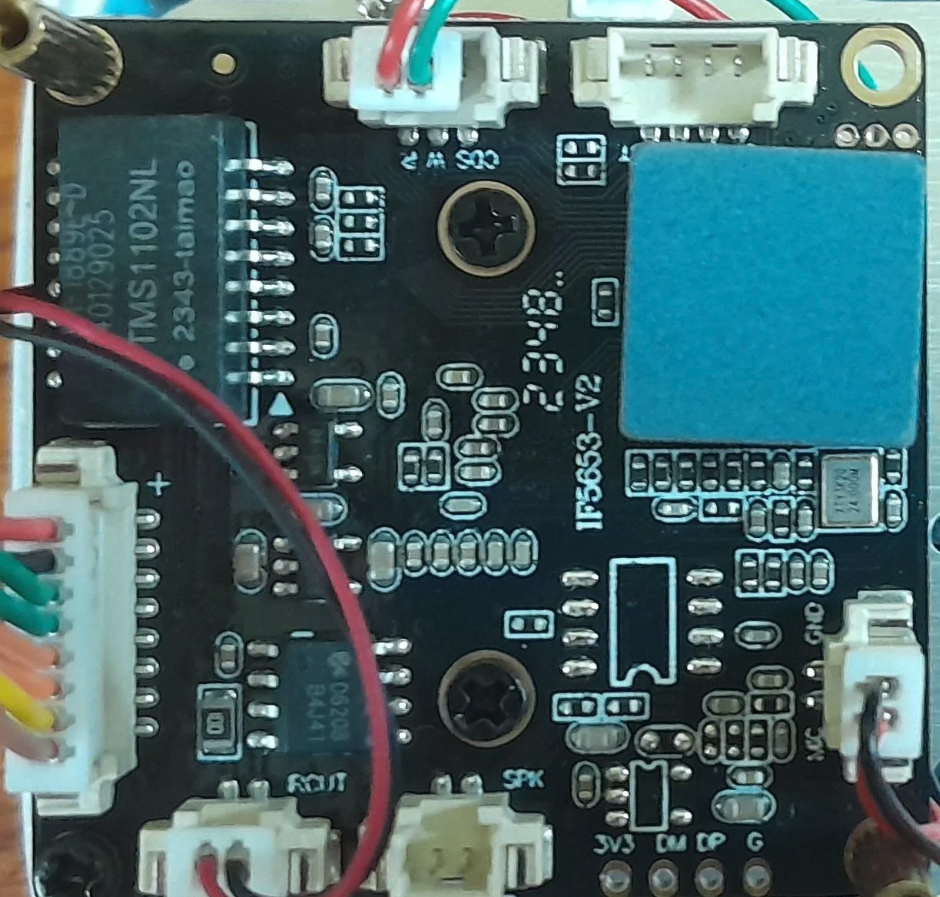

# OpenIPC Wiki
[Table of Content](../README.md)

## Asecam Vatilon PB1 (IF56N, FH8856 V100, GC4653, 8 MB NOR)



[Install Instructions](install-fullhan.md)

| Function | Setting | GPIO Pin | 
| :--- | :--- | :---: |
| IR-cut filter, opening coil | irCutPin1 | 1 |
| IR-cut filter, closing coil | irCutPin2 | 0 |
| Night Illuminator | backlightPin | 7 |
| White Light | whiteLightPin | 11 |
| Daylight Sensor | lightSensorPin | 3* |

*Note that GPIO 3 is in the stock board table, but no light sensor may be fitted: if so, leave lightSensorPin unset

### Suggested settings (/etc/majestic.yaml)
```
# Add to /etc/majestic.yaml
nightMode:
  colorNight: true
  lightMonitor: true
  whiteLight: motion
  whiteHoldSec: 120
  backlightPin: 7
  irCutPin1: 1
  irCutPin2: 0
  whiteLightPin: 11
motionDetect:
  enabled: true
```

