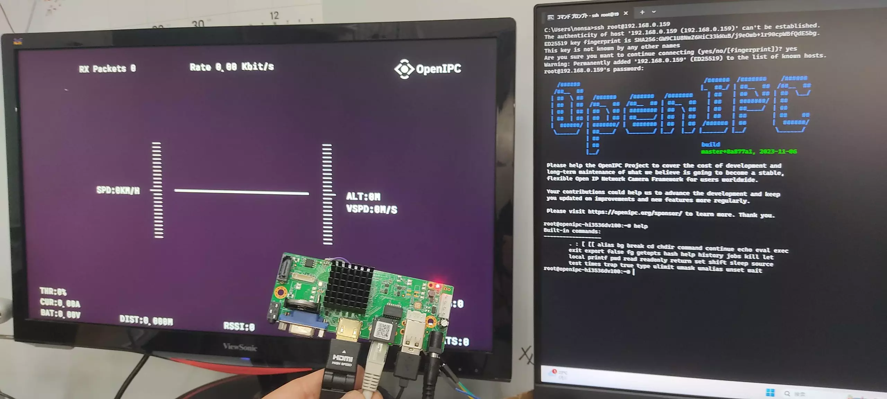

# OpenIPC Wiki
[Table of Content](../README.md)

OpenIPC FPV ground station
--------------------------


#### News roundup

- It is now possible to record video to a connected SSD or USB stick
- Both HDMI and VGA outputs now work, there are no limitations in connected displays
- A lot of different things ;)


#### Upgrade from original HI3536DV100 NVR board firmware to OpenIPC FPV firmware

- Install [PUTTY](https://www.chiark.greenend.org.uk/~sgtatham/putty/latest.html) and [TFTP](https://pjo2.github.io/tftpd64/) server
- Download actual [image](https://openipc.org/cameras/vendors/hisilicon/socs/hi3536dv100/download_full_image?flash_size=16&flash_type=nor&fw_release=fpv) for NVR from OpenIPC site
- Upload this image to your TFTP server
- Turn off NVR power, connect USB adapter to your NVR UART, specify which COM port on your PC
- Go to U-Boot with quick press Ctrl+C at power on
- Execute a set of commands each line separately

```
# Сhanging the ip address of the NVR board and the ip address of your TFTP server
setenv ipaddr 192.168.1.10; setenv serverip 192.168.1.254
mw.b 0x82000000 0xff 0x1000000
tftp 0x82000000 openipc-hi3536dv100-fpv-16mb.bin
sf probe 0; sf lock 0;
sf erase 0x0 0x1000000; sf write 0x82000000 0x0 0x1000000
reset
```

#### Boards sold with Hi3536E, or with a U-Boot password

Some sellers now ship the Xiongmai NBD8016S-KL-V2 or NBD8010S-KL-V2 board
with a chip marked **Hi3536ERBCV100** ([firmware#1796](https://github.com/OpenIPC/firmware/issues/1796)).
Hi3536E is a Hi3536DV100 variant and runs the same `hi3536dv100` firmware.
Its stock U-Boot may ask for a password that none of the published ones open.

[defib](https://github.com/OpenIPC/defib) talks to the chip's boot ROM before
any U-Boot runs, so the password does not matter. It loads OpenIPC U-Boot into
RAM over the same UART adapter, without writing flash:

```
defib burn -c hi3536dv100 -p /dev/ttyUSB0 -b   # COM3 or similar on Windows; power the board on when asked
```

At the `OpenIPC #` prompt, back up the stock flash first (the vendor firmware
is hard to find anywhere else; this is slow at 115200):

```
defib dump-flash -c hi3536dv100 -p /dev/ttyUSB0 --size 16MB -o nvr-stock.bin
```

Then open the port in PuTTY at 115200 and run the commands above, from
`setenv ipaddr` on.

If `defib burn` ends in the stock U-Boot banner instead of `OpenIPC #`, delete
the cached `u-boot-hi3536dv100-universal.bin` from defib's cache directory:
builds older than 2026-10-15 cannot set up Hi3536E memory, and the chip
resets during the upload. `-c hi3536dv100:nbd8010s`, which loads the board's
own stock SPL, also works around it.

#### The result



#### Buy a device

- [https://www.aliexpress.com/item/1005004023376532.html](https://www.aliexpress.com/item/1005004023376532.html)
- [https://www.aliexpress.com/item/1005002358182146.html](https://www.aliexpress.com/item/1005002358182146.html)
