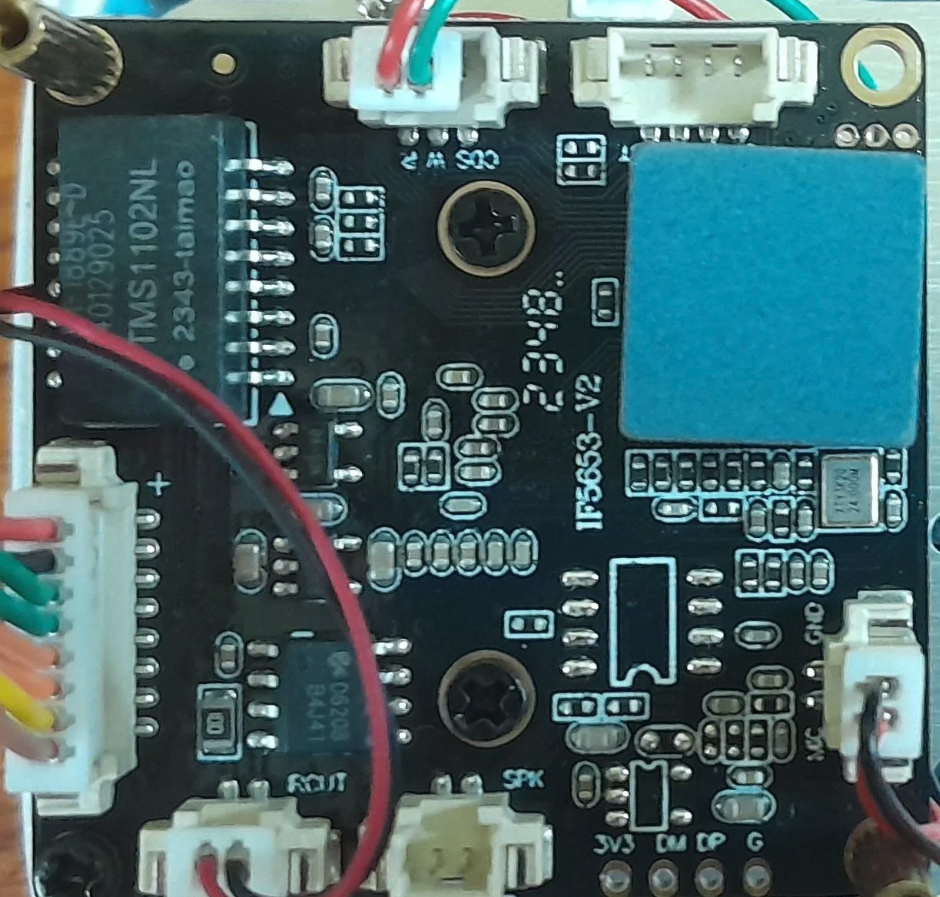

# OpenIPC Wiki
[Table of Contents](../README.md)

For Fullhan/Vatilon PB1 SOC
-----------------------------------------------------------------
The Device Info/Device Type on the OEM firmware is PB1.

### Supported Hardware

IF56N, FH8856 V100, GC4653, 8 MB NOR

### Backup of original firmware

Telnet to the camera (port 2360) from your computer using root/ipc@hs66
```
telnet <IP Address> 2360
IPCam login: root
Password: 


BusyBox v1.19.3 (2020-08-19 14:57:36 CST) built-in shell (ash)
Enter 'help' for a list of built-in commands.

Welcome to FHLinux.

```

On the camera (telnet just sets this up; the transfer is a separate TCP connection):

```
echo '#!/bin/sh' > /tmp/d.sh
echo 'exec cat /dev/mtd0 /dev/mtd1 /dev/mtd2 /dev/mtd3 /dev/mtd4 /dev/mtd5 2>/dev/null' >> /tmp/d.sh
echo '29000 stream tcp nowait root /bin/sh sh /tmp/d.sh' > /tmp/i.conf
busybox inetd /tmp/i.conf
```
Use netcat on your machine to download the data from the camera (expect 8388608 bytes)
```
nc <camera-ip> 29000 > flash_8M.bin 
```
The nc command will not return once all the image is saved to flash_8M.bin, wait 30 seconds and press Ctrl-C and check the file size. It should be 
8388608 bytes. When done:  kill the inetd you started on the camera, rm /tmp/i.conf /tmp/d.sh, and confirm the port is closed or reboot the camera

### TFTP Server
Only signed images can be installed from the OEM Camera software, therefore the UBoot startup code must be used to download and install the OpenIPC image. A TFTP server is required to supply UBoot with the image.

- Set up an TFTP server for your computer. [Instructions](installation-tftpd.md)
- Download the [Fullhan FH8856V100](https://openipc.org/cameras/vendors/fullhan/socs/fh8856v100) image
- Extract the boot files from the image and copy the individual files to the TFTP server directory. 

### Access to the UBoot prompt
UBoot must be interrupted before loading the camera software so low level access via a 3.3V USB/Serial converter is required and connected to the SOC UART. You will require a terminal emulator such as minicom set to 115200baud.
The camera must be opened up to access the UART on the board

The UART connector are the 3 small holes just above the blue square under the mounting hole in the picture.

Sewing pins can be poked into the holes for attachment to the USB/Serial converter. 


From left to right in the picture
- 1 - Connect to TXD 
- 2 - Connect to RXD 
- 3 - Connect to GND 

Start the terminal emulator with the USB/Serial converter plugged into your computer and power the camera on.
```
minicom -C /var/tmp/asecam.txt -D /dev/ttyUSB0 -8 -b 115200
```
UBoot and linux boot messages will scroll past. If not, check your connections and terminal settings and try again.

Power cycle the camera and watch for the Press any key message. This is incorrect, in fact only Ctrl C will halt to the UBoot prompt on this firmware.

Once UBoot is halted the firmware install can proceed.

### Initial device firmware install
UBoot is used to download the files to RAM then copy the RAM to the NOR flash memory.

At U-Boot>, use your own addresses on the first line:
- ipaddr is the camera IP address
- serverip is the IP address of the TFTP server

Execute each line in turn and ensure that no errors occur and the TFTP download was successful.
Check that each tftp ends with Bytes transferred = ... before running the sf erase and sf write after it. If a transfer fails, run it again. 

DANGER - Do not reset with a half-written partition.


```
setenv ipaddr 192.168.1.10; setenv serverip 192.168.1.2
setenv bootargs 'mem=29M console=ttyS0,115200 panic=20 root=/dev/mtdblock3 rootfstype=squashfs init=/init mtdparts=spi_flash:256k(boot),64k(env),2048k(kernel),5120k(rootfs),-(rootfs_data)'
setenv bootcmd 'sf probe 0; sf read 0xa1000000 0x50000 0x200000; bootm 0xa1000000'
saveenv
sf probe 0
tftp 0xa1000000 uImage.fh8856v100
sf erase 0x50000 0x200000
sf write 0xa1000000 0x50000 ${filesize}
tftp 0xa1000000 rootfs.squashfs.fh8856v100
sf erase 0x250000 0x500000
sf write 0xa1000000 0x250000 ${filesize}
sf erase 0x750000 0xb0000
reset
```
The expected install transcript:
```
U-Boot> <INTERRUPT>
U-Boot> setenv ipaddr 192.168.1.10; setenv serverip 192.168.1.2
U-Boot> setenv bootargs 'mem=29M console=ttyS0,115200 panic=20 root=/dev/mtdblock3 rootfstype=squashfs init=/init mtdparts=spi_flash:256k(boot),64k(env),2048k(kernel),5120k(rootfs),-(rootfs_data)'
U-Boot> setenv bootcmd 'sf probe 0; sf read 0xa1000000 0x50000 0x200000; bootm 0xa1000000'
U-Boot> saveenv
Saving Environment to SPI Flash...
Erasing SPI flash...Writing to SPI flash...done
U-Boot> sf probe 0
SF: Got idcode 68 40 17 68 40
use default flash ops...
spi_flash_probe_default multi wire open flag is 0
8192 KiB default_flash at 0:0 is now current device
U-Boot> tftp 0xa1000000 uImage.fh8856v100
MAC: aa:bb:cc:dd:ee:ff
set to RMII
PHY OUI: 0x937c4024 at phyid: 0
operating at 100M full duplex mode
Using FH EMAC device
TFTP from server 192.168.1.2; our IP address is 192.168.1.10
Filename 'uImage.fh8856v100'.
Load address: 0xa1000000
Loading: *^H#################################################################
         #######################################################
done
Bytes transferred = 1750744 (1ab6d8 hex)
U-Boot> sf erase 0x50000 0x200000
U-Boot> sf write 0xa1000000 0x50000 ${filesize}
U-Boot> tftp 0xa1000000 rootfs.squashfs.fh8856v100
MAC: f6:3a:80:15:4f:b3
set to RMII
PHY OUI: 0x937c4024 at phyid: 0
operating at 100M full duplex mode
Using FH EMAC device
TFTP from server 192.168.1.2; our IP address is 192.168.1.10
Filename 'rootfs.squashfs.fh8856v100'.
Load address: 0xa1000000
Loading: *^H#################################################################
         #################################################################
         #################################################################
         #################################################################
         ######################################################
done
Bytes transferred = 4608000 (465000 hex)
U-Boot> sf erase 0x250000 0x500000
U-Boot> sf write 0xa1000000 0x250000 ${filesize}
U-Boot> sf erase 0x750000 0xb0000
U-Boot> reset
resetting ...
ROM:    Use nor flash.
ROM:    Init DDR..Training done.
ROM:    Ok

```
The camera should boot to an OpenIPC login prompt. 
```
U-Boot 2010.06 (Jul 26 2022 - 14:22:43)

DRAM:  128 MiB
SF: Got idcode 68 40 17 68 40
use default flash ops...
spi_flash_probe_default multi wire open flag is 0
In:    serial
Out:   serial
Err:   serial
MMC:   FH_MMC: 0
MMC FLASH INIT: No card on slot!
Net:   set to RMII
FH EMAC
Hit any key to stop autoboot:  1  <<<<<< This is incorrect, only Ctrl-C will stop the autoboot
SF: Got idcode 68 40 17 68 40
use default flash ops...
spi_flash_probe_default multi wire open flag is 0
8192 KiB default_flash at 0:0 is now current device
## Booting kernel from Legacy Image at a1000000 ...
   Image Name:   Linux-3.0.8-fh8856v100
   Image Type:   ARM Linux Kernel Image (uncompressed)
   Data Size:    1750680 Bytes = 1.7 MiB
   Load Address: a0008000
   Entry Point:  a0008000
   Verifying Checksum ... OK
   Loading Kernel Image ... OK
OK
prepare atags

Starting kernel ...

Uncompressing Linux... done, booting the kernel.
[    0.000000] Linux version 3.0.8 (runner@runnervm0hi8g) (buildroot-gcc-13.3.0) #2 Sun Nov 22 18:37:28 UTC 2026
[    0.000000] CPU: ARMv6-compatible processor [410fb767] revision 7 (ARMv7), cr=00c5387d
[    0.000000] CPU: VIPT nonaliasing data cache, VIPT nonaliasing instruction cache
[    0.000000] Machine: FH8852

etc
Welcome to OpenIPC
openipc-fh8856v100 login:
```
Log in as root via the serial terminal or ssh root@<IPAddress>, accept the EULA and set the root password

Access the OpenIPC GUI as root via a web browser using the password set. The web GUI is accessed on port 80 by default. This can be changed via the GUI.

The suggested configuration is outlined [here](device-asecam-vatilon-pb1.md)


