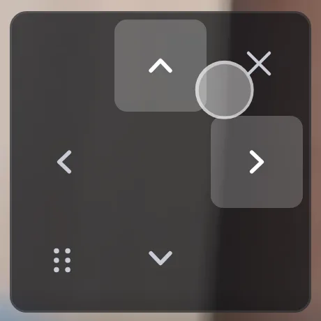

# OpenIPC Wiki
[Table of Content](../README.md)

Pan and tilt from the Live page
-------------------------------

On a camera that can turn, the **Live** page of the web interface has three ways to aim it:

| You want to | Do this |
|---|---|
| Follow something that moves | Hold the round knob on the pad and slide your thumb |
| Look at a particular spot | Double-tap it (double-click with a mouse) |
| Look a bit further over there | Drag the picture |

Each is described below, followed by what a camera needs for each, the endpoints behind them, and what to do when one is missing.

The measurements on this page come from a GK7205V510 pan/tilt head with a MIS2009 sensor (the Zenointel SD-2N-4G), streaming 1920×1080. Yours will differ in the numbers, not in how it works.

### The pad

The pad sits over the picture, at the bottom right.

**The knob.** Press anywhere on the pad and slide: the camera turns towards your thumb for as long as it stays down, and follows it as it moves. There's no need to lift the finger to change direction.
- The knob follows your thumb, and the arrows the camera is turning towards light up.
- Back on the centre, the camera stops and stays ready.
- Let go anywhere and it stops.

**Speed is distance.** There is no speed setting.
- Just outside the centre the camera turns slowly, about ten steps a second on a gpiostep head, for fine aiming.
- Further out it speeds up, gently at first and steeply towards the edge.
- At the arrows it turns at full speed.
- The speed changes in eight steps, so a thumb that wavers a little doesn't flood the camera with requests.

**Eight directions or four.**
- **Eight:** where the camera can turn both axes at once (the four diagonals are on its capability line, see below), the knob steers in eight directions.
- **Four:** otherwise it steers in four, whichever axis the thumb is further along.
- **On a line between two directions,** the camera keeps the one it had rather than flipping between them.

**A quick tap on an arrow** is still a nudge: a short move, a fifth of the configured step (`isp.autofocus.pulse`), for the last bit of aiming.

**The keyboard.** With the picture focused, the arrow keys steer at the motor's own speed. Enter or Space on an arrow is a single nudge.

**The rest of the pad:**
- **Handle** (six dots: bottom left of the pad on a phone, above it on a larger screen): drag it to move the pad to another corner of the picture. The corner is remembered by your browser. From the keyboard, Enter or Space moves it to the next corner.
- **×** (top right, on a phone): folds the pad to a single button, so it covers less of the picture.
- **Settings** (top left, when there is something to set): today that is **Follow**, on a camera that can detect something to follow (see [Follow](#follow)).

A pad with eight buttons (the stepped motors driven through `gpio-motors`) keeps its buttons; the knob replaces the Pelco-style pad of serial and gpiostep heads.

### Double-tap to centre a spot

Double-tap a point on the picture, or double-click it with a mouse, and the camera turns to put that point in the middle of the screen.
- **A ring** appears where you tapped and glides to the middle over about the time the camera takes, so you can see where it's going before the picture catches up.
- **A refused move:** if the camera refuses, the ring stops where it is, turns red, and a line says so.
- **Where the spot lands:** it goes to the middle of what you see, not of the whole frame, so Fill and a zoomed-in picture work as you'd expect.
- **No hold, no stop.** The camera gets one move per axis, *this many steps*, so there's nothing to hold and no stop that a slow link could lose.

Two things to know:
- **Fit/Fill:** on these cameras a double-click no longer switches between Fit and Fill. Those are still in the control bar.
- **Accuracy:** the wide-angle lens squeezes the edges of the picture, so a spot near the edge lands a little short. A second double-tap finishes it.

### Drag the picture to steer

In **Fit** and **Fill**, drag the picture as you would a map. The picture slides under your finger at once, showing where the camera will end up.
- **Black space** shows where the camera hasn't looked yet.
- **On release**, the camera turns exactly that far, and the picture eases back as the live view arrives.
- **Direction:** drag right and the camera turns left, so what was under your finger follows it.
- **A refused move:** the picture snaps back and a line says so.

What a drag does depends on the view:

| View | A one-finger or mouse drag |
|---|---|
| Fit, Fill | steers the camera |
| Zoomed in (pinch, wheel) or 1:1 | pans the zoomed picture |
| **Area** pressed | draws a box to zoom into |

Pinch and the mouse wheel zoom the picture as always. A second finger during a drag turns it into a pinch and sends nothing. A press that moves less than 8 pixels is a tap: it shows or hides the controls, or is half of a double-tap.

A picture standing still doesn't steer: neither the uncompressed still (**Detail**) nor the snapshot under the play button shows a turn, so neither the drag nor the double-tap moves the camera there.

The first time these gestures are available, the page says so once: *Drag the picture to turn the camera; double-tap to centre a spot.*

### Follow

**Follow** turns the head on its own to keep what the camera sees in the middle of the picture. Switch it on from the pad's settings, or as `ptz.track` on the **PTZ** settings tab, and choose there what it follows:

| Setting | Follows |
|---|---|
| `ptz.trackPeople` (on by default) | people |
| `ptz.trackAnimals` | cats and dogs, for a pet left at home |
| `ptz.trackVehicles` | cars, trucks, buses, motorcycles, bicycles |

What it follows is separate from what object detection alerts on. Following needs no alerts: it starts the detector on its own, and following a cat raises no animal alert, event or recording. Switching it on or off restarts the detector, not the video.

Once it has picked someone it keeps them: the nearest box of the same kind in the next frames, never one of another kind, until they have been gone for five seconds. A cat it is following is not swapped for a person walking past. The followed subject is outlined on the Live picture.

It looks, then turns: once the head has stopped and the picture has settled it decides, and turns by the number of steps that brings the subject to the middle. Where the head reports its frame in steps (`frame=` below) it turns both axes in the same move, the shorter one more slowly so both arrive together, and so goes straight at the subject. Otherwise it turns one axis per move. Any move from the pad, ONVIF or DVRIP pauses following for `ptz.trackResumeSec` (15 s by default).

On a camera with a neural processor (GK7205V5x0) it can follow people, animals and vehicles, including someone standing still. On one that detects on its CPU it follows people only. That detector only looks where something moved, so while the head follows someone, it also keeps looking where they are, and someone who stops is not lost.

At night it pairs with the white lamp: with `nightMode.whiteLight: detect` the person it follows is also lit in colour (see [The white lamp on a sighting](majestic-streamer.md#the-white-lamp-on-a-sighting)).

### What a camera needs

| Feature | Needs |
|---|---|
| The knob | A pan/tilt head driven through majestic: a Pelco head on a serial line, or a gpiostep head |
| Speed by distance | A motor that keeps a speed: `speeds=` on the capability line |
| Eight directions | The diagonals on the capability line: `upleft`, `upright`, `downleft`, `downright` |
| Double-tap and drag | Counted moves (`steps=`) and the frame size in steps (`frame=WxH`); a picture that isn't rotated 90° or 270° |
| Follow | Counted moves (`steps=`) and object detection (`follow=` on the capability line); `frame=` for both axes in one move |

The diagonals, two-axis counted moves and `frame=` come with [majestic-af](https://github.com/OpenIPC/majestic-af), the motor plugin. A firmware whose majestic-af predates them gets the knob in four directions and no double-tap or drag. Updating the web interface alone doesn't add them.

### The steps a frame takes

Double-tap and drag turn "this far across the picture" into "this many steps", so the camera has to know how many steps turn it by one whole frame. A gpiostep head reads that from its board description, `/etc/gpiostep.conf`:

| Key | Meaning |
|---|---|
| `pan_frame_steps` | Pan steps that turn the head by one frame width. 0 or absent: unknown. At most 2000. |
| `tilt_frame_steps` | Tilt steps that turn it by one frame height. The same. |

The SD-2N-4G's profile ships `pan_frame_steps=134` and `tilt_frame_steps=62`. At 1920×1080 that is about 14.3 pixels per pan step and 17.5 per tilt step.

**To measure them for another head:**
1. Point it at something with plenty of detail, not a plain wall or a glossy surface whose reflections move with the camera.
2. Take a snapshot (`/image.jpg`).
3. Move a known number of steps (`POST /ptz?move=right&steps=12`), wait for it to finish, and take another snapshot.
4. Measure how far the picture shifted, in pixels. A phase correlation of the two snapshots does it; so does lining them up in an image editor.
5. Keep the moves small (6–24 steps) and use the middle of the picture, where the lens distorts least.
6. Steps per frame is the frame width (or height) divided by the pixels per step.

Both keys are read when majestic starts.

### For scripts

The pad and the gestures use only the camera's own endpoints:

| Request | Does |
|---|---|
| `GET /ptz` | The capability line, for example `actuator=gpiostep pulse=500 state=ready verbs=stop,up,down,left,right,upleft,upright,downleft,downright speeds=1-100 steps=1 frame=134x62` |
| `POST /ptz?move=<verb>&ms=<ms>&speed=<1-100>` | Turns for `ms` milliseconds (the default is `isp.autofocus.pulse`). Repeat it to keep turning; `move=stop` stops. `speed` only where `speeds=` is offered. |
| `POST /ptz?move=<verb>&steps=<1-1000>&speed=<1-100>` | Turns exactly that many steps and stops by itself. Only where `steps=` is offered. |

On the capability line:
- **`verbs=`** lists what the head can do. The four diagonals turn pan and tilt together.
- **`frame=WxH`** is the steps per frame, from the board's description.
- **`follow=`** lists what this camera can detect and so follow, for example `follow=human,vehicle,animal`, or `follow=human` where it detects on its CPU. It is absent where the camera can detect nothing.

A counted pan move and a counted tilt move sent one after the other run together: the head turns both, and each stops on its own count. That is how a double-tap reaches a spot diagonally. A counted move on the same axis replaces the one running there.

### Troubleshooting

**There is a knob but no double-tap or drag.**
- `GET /ptz` has no `steps=`: the motor cannot count its steps (a Pelco head only switches moves on and off), so it can't do either. That is the head, not a setting.
- `GET /ptz` has no `frame=`: either the board's `gpiostep.conf` has no frame keys, or the firmware's majestic-af predates them.
- A picture rotated 90° or 270° turns them off as well.
- If the page loaded while the camera wasn't answering, it asks again on its own over the next two minutes, and at the next touch of the picture.

**There is no Follow switch on the pad.** `GET /ptz` needs both `steps=` and `follow=`. No `follow=`: the camera has nothing to detect with (no neural processor and no CPU detector model in its firmware).

**The knob only goes in four directions.** `GET /ptz` doesn't list the diagonals. The motor plugin predates them; on Pelco heads they need a current majestic-af too.

**Double-tap turns the camera the wrong way.** The page reads the picture's **Mirror** and **Flip** (`image.mirror`, `image.flip`) when it loads. If either was changed since, reload the page.

**A drag pans the picture instead of turning the camera.** The view is zoomed in or at 1:1, where a drag pans the zoomed picture. Switch to **Fit** or **Fill** in the control bar.

**The camera stops short of a spot near the edge.** The lens squeezes the edges of the picture. Double-tap again.

See also [Motor control](motors.md) for the kinds of motor OpenIPC drives, and [Autofocus and manual focus](autofocus.md) for the lens buttons on the same pad.
