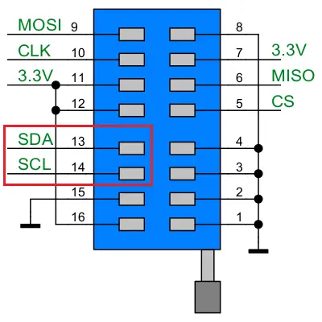
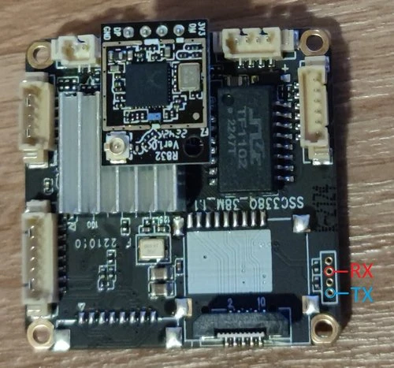
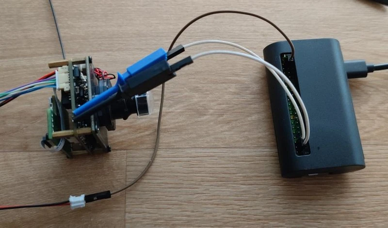

# OpenIPC Wiki
[Table of Content](../README.md)

Sigmastar unbrick
---

The flash of a SigmaStar board is reached through the ISP bridge of its SoC, over the UART pins,
with a CH341A or a CH347 programmer and [microsnander](https://github.com/OpenIPC/microsnander)
on Linux. Nothing is desoldered.

> The previous version of this page used `snander-mstar`, which is archived now. It is still
> there, with its Windows build:
> [the page with snander-mstar](https://github.com/OpenIPC/wiki/blob/1f68128/en/sigmastar-unbrick.md),
> [snander-mstar releases](https://github.com/OpenIPC/snander-mstar/releases).

---

**Locate the Sigmastar UART output and connect it to the CH341A I2C:**
- $\color{dimgray}{\texttt{GND -> GND (PIN 1-4)}}$
- $\color{deepskyblue}{\texttt{TX -> SDA I2C (PIN 5)}}$
- $\color{orange}{\texttt{RX -> SCL I2C (PIN 6)}}$





- The black CH341A board puts 5 V on SDA and SCL unless it is modified for 3.3 V
  ([CH341A voltage fix](hardware-programmer-ch341a-voltage-fix.md)); the UART of the SoC is not
  made for 5 V.
- A CH347 (CH347T in mode 1, or CH347F) works the same way, on its I2C pins.

---

**Download microsnander:**
- Static Linux builds, no installation:
  [x86_64](https://github.com/OpenIPC/microsnander/releases/latest/download/microsnander-linux-x86_64),
  [ARM](https://github.com/OpenIPC/microsnander/releases/latest/download/microsnander-linux-arm)
  (Raspberry Pi and other boards),
  [all builds](https://github.com/OpenIPC/microsnander/releases/latest)
```
wget https://github.com/OpenIPC/microsnander/releases/latest/download/microsnander-linux-x86_64 -O microsnander
chmod +x microsnander
```
- Run it as root (`sudo`), or allow the programmer to a group with a udev rule:
  [microsnander README, Requirements](https://github.com/OpenIPC/microsnander#requirements).

---

**Check the device flash:**
- The device must be powered when connected to the programmer.
- Power cycling might help if the device can not be detected.
```
sudo ./microsnander -m sigmastar -i -q
```
`-q` lists the I2C addresses that answer (the bridge must be at `0x49`), then `-i` detects the
flash:
```
SigmaStar ISP through the I2C of the CH341A at 0x49.
Detected SPI NOR Flash: W25Q64JVIM, Flash Size: 8 MB, SR: [00] [00] [60]
```

**Back up the flash first:**
```
sudo ./microsnander -m sigmastar -r backup.bin
```

**Erase the boot partition:**
```
sudo ./microsnander -m sigmastar -l 0x200000 -e
```

**Write the new uboot file and verify it:**
- https://github.com/openipc/firmware/releases/tag/latest
- drop the file into the same folder as the program
```
sudo ./microsnander -m sigmastar -w u-boot-ssc338q-nand.bin -v
```

**A whole firmware image:** a full image of the
[image release](https://github.com/OpenIPC/firmware/releases/tag/image) (for example
`openipc-ssc325-nor-lite.bin` for an 8 MB NOR flash) is written the same way, after a full erase:
```
sudo ./microsnander -m sigmastar -e
sudo ./microsnander -m sigmastar -w openipc-ssc325-nor-lite.bin -v
```

It is slow: the data goes over I2C. A bootloader is minutes; a whole 8 MB NOR flash takes about
13 minutes to write and as long to verify. `-S 400K` (or `750K`) sets a faster I2C clock, when
the wires allow it (`100K` by default).

More: [microsnander README, SigmaStar ISP](https://github.com/OpenIPC/microsnander#sigmastar-isp).

---

**I2C devices:**
- 0x49 -> MStar ISP
- 0x59 -> MStar Debug

---

**Important to know:**

After successfully restoring the bootloader or installing it into a clean NOR/NAND flash chip, you will be able to access it on the ttyS0 port (intended for engineering connections and debugging) in your SigmaStar device.

---

- [Alternative Raspberry method by MarioFPV](https://youtu.be/88C8UvyKQlQ)
- [Some other info from chenxing](https://linux-chenxing.org/isp/)
